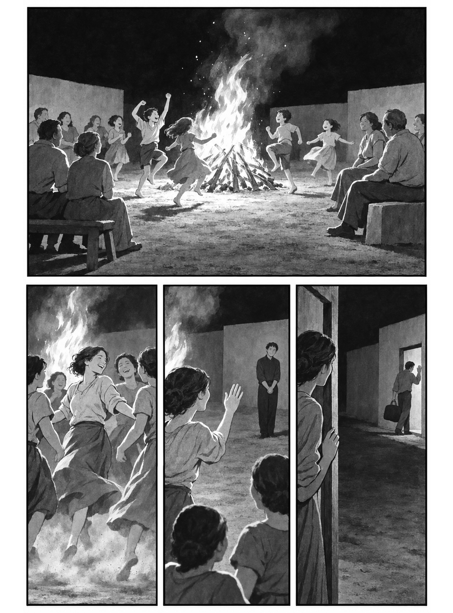

# Novel Illustrator

A portable agent skill and Python toolkit for turning EPUB novels into source-grounded illustrated editions. Use it with Codex or Google Antigravity.

## What it does

- Builds four-panel illustrations from events established in the corresponding chapter.
- Verifies every panel quote against extracted chapter text.
- Tracks characters, clothing, objects, and locations progressively to reduce continuity errors and spoilers.
- Targets Kindle Paperwhite 7th generation with 1072 x 1448, 8-bit grayscale illustrations.
- Preserves the original EPUB content and adds each approved image on a dedicated fullscreen page after its chapter.
- Includes tools to inspect EPUB structure, verify quotes, and compile the illustrated edition.

## Sample illustrations

These Chapter 1 examples show how the workflow adapts to different novels while preserving source-specific scenes and grayscale presentation.

### The First Fifteen Lives of Harry August, Chapter 1


### The Inverted World, Chapter 1



## Install the skill

Codex and Antigravity both discover workspace skills in `.agents/skills/`. For user-wide installation, use each agent's global directory.

| Scope | Codex | Antigravity |
| --- | --- | --- |
| Workspace | `.agents/skills/novel-illustrator/SKILL.md` | `.agents/skills/novel-illustrator/SKILL.md` |
| User | `~/.agents/skills/novel-illustrator/SKILL.md` | `~/.gemini/config/skills/novel-illustrator/SKILL.md` |

Clone this repository into one of the skill directories listed above. The following commands cover workspace and user-wide installation.

### Windows PowerShell

```powershell
# Workspace scope
New-Item -ItemType Directory -Force ".agents\skills" | Out-Null
git clone https://github.com/NatBrian/novel-illustrator.git ".agents\skills\novel-illustrator"

# Codex user scope
New-Item -ItemType Directory -Force "$env:USERPROFILE\.agents\skills" | Out-Null
git clone https://github.com/NatBrian/novel-illustrator.git "$env:USERPROFILE\.agents\skills\novel-illustrator"

# Antigravity user scope
New-Item -ItemType Directory -Force "$env:USERPROFILE\.gemini\config\skills" | Out-Null
git clone https://github.com/NatBrian/novel-illustrator.git "$env:USERPROFILE\.gemini\config\skills\novel-illustrator"
```

### macOS and Linux

```bash
mkdir -p .agents/skills
git clone https://github.com/NatBrian/novel-illustrator.git .agents/skills/novel-illustrator

mkdir -p ~/.agents/skills
git clone https://github.com/NatBrian/novel-illustrator.git ~/.agents/skills/novel-illustrator

mkdir -p ~/.gemini/config/skills
git clone https://github.com/NatBrian/novel-illustrator.git ~/.gemini/config/skills/novel-illustrator
```

Start a new agent session after installation. See the official [Codex skill directories and setup](https://developers.openai.com/api/reference/cli#use-the-cli-from-a-coding-agent) and [Antigravity skill locations](https://antigravity.google/docs/migration/workflows-to-skills/).

## Python toolkit

The scripts require Python 3.10 or later. Install Pillow for image conversion during EPUB compilation:

```bash
python -m pip install Pillow
```

### 1. Inspect an EPUB

```bash
python scripts/inspect_epub.py "novel.epub" --out-dir ./work
```

Review the generated spine summary and chapter text before drafting image briefs.

### 2. Verify panel quotes

```bash
python scripts/verify_quotes.py \
  --chapters work/chapters_raw.json \
  --briefs work/image_briefs.json
```

### 3. Compile the illustrated EPUB

```bash
python scripts/compile_epub.py "novel.epub" \
  --briefs work/image_briefs.json \
  --images-map work/approved_images.json \
  --out "novel_illustrated.epub"
```

Compilation defaults to 1072 x 1448 grayscale JPEGs. Use `--color` only when a color edition is intended.

## Repository layout

```text
novel-illustrator/
|-- SKILL.md
|-- README.md
|-- .gitignore
|-- docs/
|   |-- showcase/
|       |-- first-fifteen-lives-chapter-01.png
|       |-- inverted-world-chapter-01.png
|-- references/
|   |-- art-direction-eink.md
|   |-- qc-checklist.md
|-- scripts/
    |-- inspect_epub.py
    |-- verify_quotes.py
    |-- compile_epub.py
```
